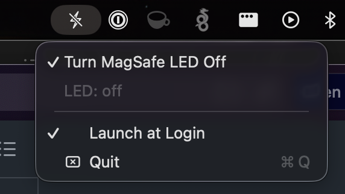

# MagSafeLED

A tiny macOS menubar app that turns off the MagSafe charging LED on Apple Silicon MacBooks—and keeps it off when you replug the cable.

The bright green or orange glow is easy to ignore at a desk, but annoying in a dark bedroom or while watching a movie. MagSafeLED turns it off completely.

*(Yes, a piece of electrical tape would also work. The tape was in a drawer somewhere, and vibecoding this with Claude was faster than looking for it.)*



## Requirements

- Apple Silicon Mac with MagSafe 3
- macOS 13 or later
- Xcode or Xcode Command Line Tools (Swift 5.9+)

*Tested on an M3 MacBook Air (`Mac15,12`) running macOS 26.5.1.*

## Installation

Clone the repo, build from source, and run the installer:

```bash
git clone https://github.com/mattmoyer/MagSafeLED.git
cd MagSafeLED
scripts/build.sh
sudo scripts/install.sh
open /Applications/MagSafeLED.app
```

**What the installer does:** Copies the background helper to `/Library/PrivilegedHelperTools/`, registers it as a LaunchDaemon (`com.moyer.magsafeledd`), and copies the app to `/Applications`.

## Usage

1. Click the bolt icon in your menubar and select **Turn MagSafe LED Off**.
2. *(Optional)* Enable **Launch at Login** if you want quick access to the menu.

Once turned off, the background helper enforces your setting automatically—even across reboots or if you quit the menubar app.

### Can't find the menubar icon?

If you have a notched MacBook with a crowded menubar, macOS might hide the icon behind the notch. Just re-open `MagSafeLED.app` from Spotlight or Finder while it's already running, and the menu will pop up right at your cursor.

## Uninstall

```bash
sudo scripts/uninstall.sh
```

This removes the app, the background helper, its LaunchDaemon, and your saved setting, then hands LED control back to the Mac's firmware (`ACLC = 00`).

## How it works

The MagSafe LED is controlled by an undocumented SMC key called `ACLC`:

| Value | Meaning                       |
|-------|-------------------------------|
| `00`  | Firmware controlled (default) |
| `01`  | Off                           |
| `03`  | Green                         |
| `04`  | Orange                        |

Any user can read SMC keys, but writing to them requires root. Additionally, the Mac's firmware resets the LED whenever you reconnect the cable or the charging state changes.

To handle this, MagSafeLED is split into two parts:

- **`magsafeledd` (root LaunchDaemon):** Writes `ACLC = 01` via IOKit (`AppleSMC`). It re-applies the setting on wake, when the power source changes, and via a 2-second polling check in case the firmware resets it. State is saved in `/Library/Application Support/MagSafeLED/`.
- **`MagSafeLED.app` (menubar app):** Shows the current LED status and toggles the setting by talking to the daemon over XPC.

## Good to know

- **Brief flash on plug-in:** When you first connect the MagSafe cable, the LED may light up briefly before the daemon catches it and turns it off.
- **Security:** The XPC service only accepts connections from root or the active console user. Its only capability is toggling the `ACLC` key between `01` (off) and `00` (default).
- **Signing:** Binaries are ad-hoc signed, so the helper is installed as a standard LaunchDaemon rather than through `SMAppService`.
- **Future updates:** Because `ACLC` is undocumented, a future macOS or firmware update could change how it behaves.

## Debugging

Read the current LED state (no root required):

```bash
.build/release/magsafeledd --read ACLC
```

Stream the daemon logs to watch it enforce the setting:

```bash
log stream --level info --predicate 'subsystem == "com.moyer.magsafeledd"'
```

## Credits

- **[hholtmann/smcFanControl](https://github.com/hholtmann/smcFanControl):** Demonstrated how to read/write SMC keys from user space via `AppleSMC`. This project uses the same SMC parameter struct layout.
- **[r/mac comment](https://www.reddit.com/r/mac/comments/ynvgm2/how_to_disable_magsafe_cable_led/ov55bzr/) by [u/DepartmentSweet4260](https://www.reddit.com/user/DepartmentSweet4260):** Pointed out that `ACLC = 01` disables the MagSafe LED and needs to be re-applied after replugging.
- **[actuallymentor/battery](https://github.com/actuallymentor/battery):** Source of the known `ACLC` values.

## License

Licensed under GPL-2.0-or-later (matching smcFanControl's `smc` tool, which the SMC logic is based on). See [LICENSE](LICENSE) for details. The `ACLC` key values originate from [actuallymentor/battery](https://github.com/actuallymentor/battery) (MIT, which is GPL-compatible).
